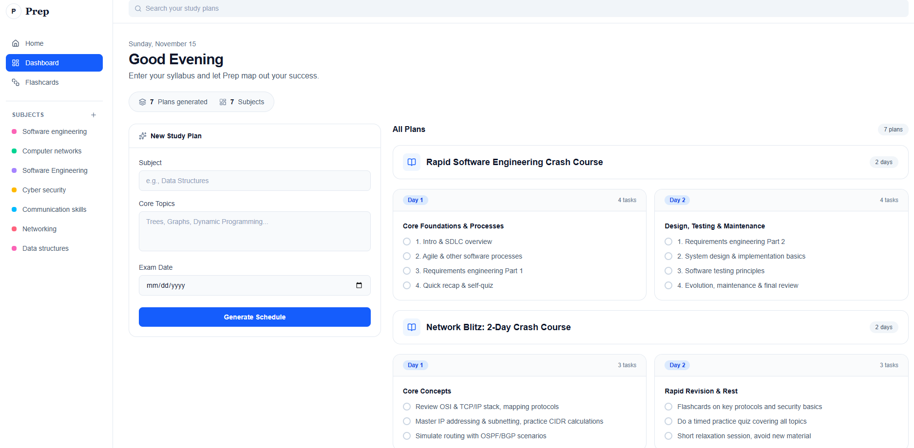
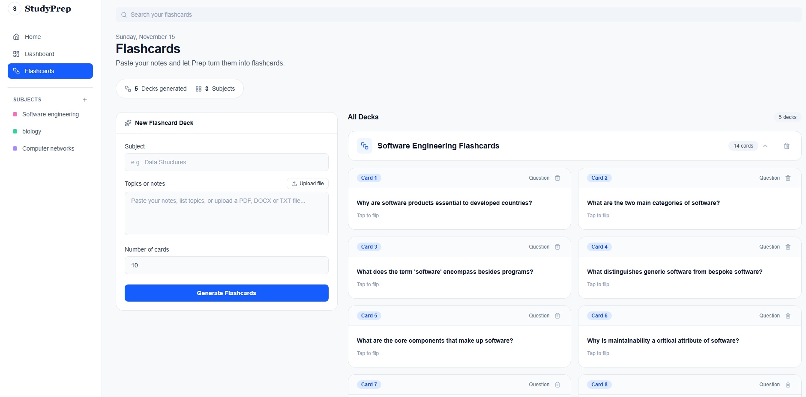

# StudyPrep

**AI-powered study planner and flashcard generator.**
Turn your subject, topics and exam date into a day-by-day revision plan, and turn your notes or documents into flashcards.


<!-- Add a screenshot or GIF of the dashboard here -->


---




---

## Table of Contents

- [Overview](#overview)
- [Features](#features)
- [How It Works](#how-it-works)
- [Tech Stack](#tech-stack)
- [Getting Started](#getting-started)
- [Environment Variables](#environment-variables)
- [Project Structure](#project-structure)
- [Data Model](#data-model)
- [API Reference](#api-reference)
- [Deployment](#deployment)
- [Roadmap](#roadmap)
- [Contributing](#contributing)
- [License](#license)
- [Author](#author)

---

## Overview

Students often know *what* they need to study but not *how to spread it* across the time they have left. StudyPrep closes that gap. You enter a subject, the topics you need to cover and your exam date, and it builds a realistic schedule that fits the days you actually have. A 2-day crash course and a 3-week plan look very different, and StudyPrep plans for both.

It also generates flashcards from your own notes or uploaded documents, so revision material is ready in seconds.

## Features

### Study plans
- **Exam-aware scheduling.** The number of days is calculated from the exam date on the server, so a plan for an exam in 3 days has exactly 3 days.
- **Prioritisation.** When time is short, the highest-yield topics come first, and the final day is kept for light revision.
- **Saved plans.** Every plan is stored per user and can be revisited at any time.
- **Subject organisation.** Filter plans by subject from the sidebar, and search across subjects, topics, titles and individual tasks.

### Flashcards
- **Generate from notes.** Paste notes or list topics, choose how many cards you want (5 to 30), and get a deck.
- **Upload a document.** Extract text from PDF, DOCX, TXT and Markdown files and generate cards from it.
- **Flip-to-reveal cards.** Question on the front, answer on the back.
- **Manage your decks.** Search across decks and cards, filter by subject, and delete a single card or a whole deck.

### Platform
- **Authentication.** Secure, cookie-based sessions with protected routes and API endpoints.
- **Responsive layout.** Desktop sidebar and a mobile bottom navigation bar.
- **Safe deletion.** Destructive actions use a type-to-confirm dialog.

## How It Works

1. **Sign up or log in.**
2. **Create a plan.** Enter a subject, your core topics and your exam date.
3. **Plan generation.** The server computes the days remaining and sends the AI a strict day count, so the plan always fits your timeline.
4. **Review and save.** The schedule is stored and appears on your dashboard.
5. **Make flashcards.** Open the Flashcards page, paste notes or upload a file, and generate a deck.

## Tech Stack

| Layer | Technology |
|---|---|
| Framework | Next.js (App Router), React, TypeScript |
| Styling | Tailwind CSS, Lucide icons |
| Database | PostgreSQL on Supabase |
| ORM | Prisma (with the `pg` driver adapter) |
| AI | Groq API (`openai/gpt-oss-20b`) |
| Document parsing | `unpdf` (PDF), `mammoth` (DOCX) |
| Hosting | Vercel |

## Getting Started

### Prerequisites

- Node.js 18.18 or later
- A [Supabase](https://supabase.com) project (or any PostgreSQL database)
- A [Groq](https://console.groq.com) API key

### Installation

```bash
# 1. Clone the repository
git clone https://github.com/<your-username>/prepwise.git
cd prepwise

# 2. Install dependencies
npm install

# 3. Set up environment variables
cp .env.example .env
# then fill in the values (see below)

# 4. Create the database tables and generate the Prisma client
npx prisma db push
npx prisma generate

# 5. Start the development server
npm run dev
```

Open [http://localhost:3000](http://localhost:3000) in your browser.

> **Note:** If you add or change a model in `prisma/schema.prisma`, run `npx prisma db push` and `npx prisma generate` again, then restart the dev server.

## Environment Variables

Create a `.env` file in the project root:

| Variable | Description |
|---|---|
| `DATABASE_URL` | PostgreSQL connection string (Supabase pooler URL) |
| `GROQ_API_KEY` | API key from the Groq console |
| `JWT_SECRET` | Secret used to sign session tokens |

Never commit your `.env` file. Keep an `.env.example` with empty values so contributors know what is needed.

## Project Structure

```
PrepWise/
├── app/
│   ├── api/
│   │   ├── auth/            # login, signup, logout
│   │   ├── generate/        # AI study-plan generation
│   │   ├── plans/           # save plans
│   │   │   └── [id]/        # delete a plan
│   │   ├── flashcards/      # generate and save a deck
│   │   │   └── [id]/        # delete a deck, remove a card
│   │   └── extract/         # text extraction from uploaded files
│   ├── auth/                # sign in / sign up pages
│   ├── dashboard/           # study plans dashboard
│   ├── flashcards/          # flashcards page
│   ├── plans/               # saved plans page
│   └── components/          # shared UI components
├── lib/
│   ├── prisma.ts            # Prisma client
│   └── auth.ts              # token signing and verification
├── prisma/
│   └── schema.prisma        # database schema
├── public/
├── .env.example
├── package.json
└── README.md
```

## Data Model

```prisma
model User {
  id        String          @id @default(uuid())
  name      String?
  email     String          @unique
  password  String
  plans     StudyPlan[]
  createdAt DateTime        @default(now())
}

model StudyPlan {
  id        String   @id @default(uuid())
  userId    String
  subject   String
  topics    String
  examDate  DateTime
  schedule  Json     // { title, days: [{ day, date, focus, tasks[] }] }
  createdAt DateTime @default(now())
}

model FlashcardDeck {
  id        String   @id @default(cuid())
  userId    String
  title     String
  subject   String
  cards     Json     // [{ front, back }]
  createdAt DateTime @default(now())
}
```

## API Reference

All endpoints except authentication require a valid session cookie.

| Method | Endpoint | Description |
|---|---|---|
| `POST` | `/api/generate` | Generate a study plan from `{ subject, topics, examDate }` |
| `POST` | `/api/plans` | Save a generated plan |
| `DELETE` | `/api/plans/:id` | Delete one of your plans |
| `POST` | `/api/flashcards` | Generate and save a deck from `{ subject, notes, count }` |
| `PATCH` | `/api/flashcards/:id` | Remove a single card from a deck (`{ removeIndex }`) |
| `DELETE` | `/api/flashcards/:id` | Delete a deck |
| `POST` | `/api/extract` | Extract text from an uploaded PDF, DOCX, TXT or MD file (max 4 MB) |

Users can only read, modify or delete their own data. Every query is scoped to the authenticated user's ID.

## Deployment

StudyPrep is designed to deploy on [Vercel](https://vercel.com):

1. Push the repository to GitHub and import it into Vercel.
2. Add the environment variables from the table above in the project settings.
3. Deploy. Run `npx prisma db push` against your production database once before first use.

Uploaded files are processed in memory and are not stored. Vercel limits request bodies to roughly 4.5 MB, which is why uploads are capped at 4 MB.

## Roadmap

- [x] AI study plans based on exam date
- [x] Flashcard generation from notes and uploaded documents
- [x] Search, subject filtering and deletion
- [ ] Account deletion
- [ ] Flashcard study mode with "got it / review again" tracking
- [ ] Generate flashcards directly from a saved study plan
- [ ] PowerPoint (.pptx) support for uploads
- [ ] Progress tracking dashboard
- [ ] Smart reminders and notifications
- [ ] Calendar integrations (Google Calendar, Notion)
- [ ] Collaborative study groups

## Contributing

Contributions are welcome.

1. Fork the repository
2. Create a feature branch: `git checkout -b feature/your-feature`
3. Commit your changes: `git commit -m "Add your feature"`
4. Push the branch: `git push origin feature/your-feature`
5. Open a Pull Request

Please keep pull requests focused and describe what changed and why.

## License

Distributed under the MIT License. See `LICENSE` for details.

## Author

**Kelvin Kipchumba**
Portfolio: [kelvinkipchumba.dev](https://kelvinkipchumba.dev)

---

*Built to make exam preparation smarter and simpler.*